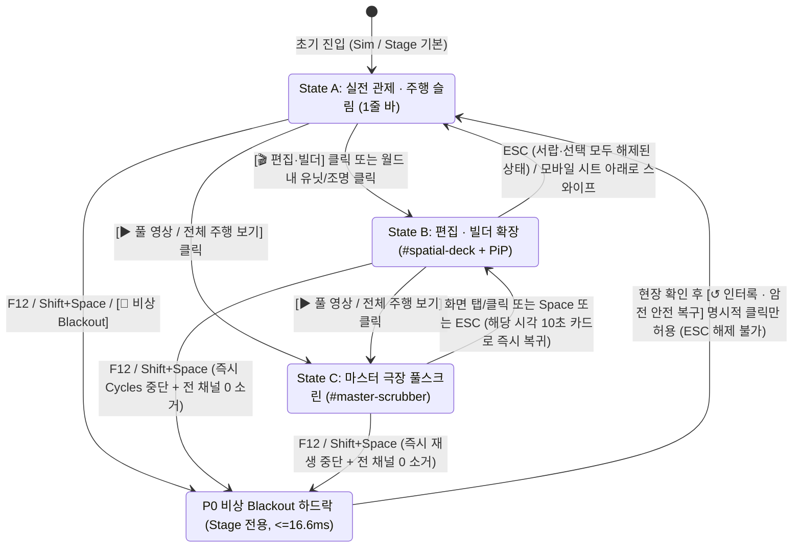
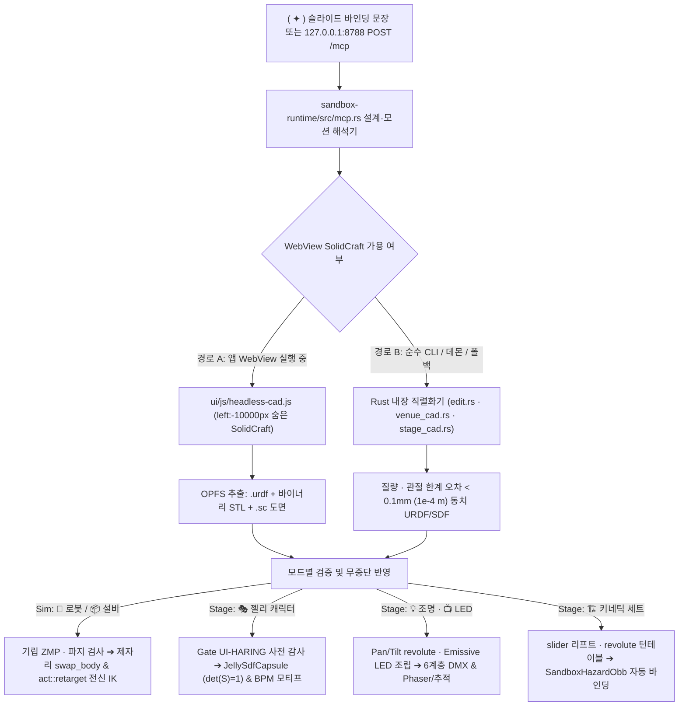

# vision-sandbox v1.8 — `ui-draft.docx` 기반 2축 슬라이드 덱(`#spatial-deck`) · 모바일 4단 스택 · 2중 헤드리스 SolidCraft 통합 개발 기획안

- **작성일**: 2026-11-27
- **원본 기획 문서**: `ui-draft.docx` (총 6개 설계 턴 · 820블록 전문 분석 반영)
- **기준 코드베이스**: `louis-vision` (`HEAD 30300b2`), `premium-discount` (`HEAD 57a3c17`), `logis-center` (`HEAD e162e952`), `studio.popup.link` (`HEAD 97d77b5`)
- **적용 대상**: `louis-vision/apps/vision/` (`🧪 Sim Sandbox` & `🔴 XR Stage Live` 단일 캔버스 통합 UI · 런타임 · MCP 백엔드)

> [!IMPORTANT]
> 본 기획안은 코드 참조 없이 작성된 `ui-draft.docx`의 모든 제안 항목을 실제 저장소 소스코드 및 N:N 검증 스위트([run_playwright_ui_nn.mjs](file:///C:/Users/lp/Documents/GitHub/louis-vision/apps/shared-ui/tests/run_playwright_ui_nn.mjs), [xr_stage_and_cargo_nn.rs](file:///C:/Users/lp/Documents/GitHub/louis-vision/apps/vision/tests/xr_stage_and_cargo_nn.rs), [source_split.rs](file:///C:/Users/lp/Documents/GitHub/louis-vision/apps/vision/crates/sandbox-core/tests/source_split.rs), [cross_hygiene.rs](file:///C:/Users/lp/Documents/GitHub/premium-discount/crates/pd-vision-eval/src/cross_hygiene.rs))와 1:1 대조하여, **기구현 자산 재활용 · 미구현 백엔드/UI 갭 보완 · 회귀 함정 원천 차단**을 반영한 실행 명세서입니다.

---

## 0. 핵심 아키텍처 요약 (Executive Summary)

`ui-draft.docx`의 최종 확정 설계는 화면 사방에 흩어진 개별 드롭업·팝업·가로형 멀티트랙 편집기를 걷어내고, **`🧪 Sim Sandbox`와 `🔴 XR Stage Live` 두 모드의 조작 문법을 단일 풀스크린 3D 뷰포트(`#world-canvas`) 위의 2축 직교 슬라이드 덱(`#spatial-deck`)과 우하단 `( ✦ )` 통합 MCP 런처 하나로 100% 통일**하는 것입니다.

1. **반응형 2원 레이아웃 골격**
   - **태블릿 · 데스크톱 (`>= 760px`)**: 풀스크린 `#world-canvas` 위 **5-Slot 고정 배치** (`#corner-tl`, `#corner-tr`, Stage 전용 불변 `#stage-interlock-hud`, 하단 중앙 플로팅 유리 독 `#spatial-deck` `max-width: 720px`, 우하단 `#lv-star-root`).
   - **모바일 세로 (`< 760px`, `LayoutMode::Full`)**: 마크업 복제 없이 CSS 반응형으로 전환되는 **4단 단일 세로 스택** (① 상단 `.pill-nav` + Stage 안전 띠 → ② 중앙 3D 뷰포트 `>= 45%` → ③ `═══` 드래그 핸들 바텀시트 `#spatial-deck` → ④ 최하단 정박 `#lv-star-root` 입력줄) 및 무대 거치 폰(`WirelessCameraRig`) `#000000` 전면 터치 잠금.
2. **3단 화면 상태 전이 (`State A` ⇄ `State B` ⇄ `State C`)**
   - **State A (실전 관제·주행 슬림)**: 하단 1줄 바(`#sim-transport-row` / `#stage-cue-row`)만 노출해 3D 시야 100% 개방.
   - **State B (`[🎬 편집·빌더]` 슬라이드 덱 오픈)**: 1줄 레이어 필터 칩(`all | cam | actor | light | set`) + 1줄 수평 슬라이드 트랙 + 선택 카드 `[▾]` 인라인 서랍 + 좌측 `#vp-minimap` 마스터 연결 PiP 모니터.
   - **State C (`[▶ 풀 영상 / 전체 주행 보기]` 마스터 극장)**: 모든 슬라이드 접힘 + 하단 1줄 `#master-scrubber` 연속 재생; 화면 클릭 또는 `Space` 입력 시 즉시 해당 시각의 10초 슬라이드 카드(`State B`)로 복귀.
3. **2축 직교(`X × Y`) 조작 규칙 ("슬라이드 유무 = 무대 존재·점등")**
   - **X축 (수평 스냅)**: 모든 트랙은 **기본 2개 카드**로 가볍게 시작 → 오른쪽 끝 스와이프 시 `[ ➕ 새 요소 추가 ]` 고스트 카드(예상 프레임 예산 증분 표시) 노출 → `[✕]` 클릭 시 현재 구간에서만 소등·퇴장(Mute, 실제 인체 안전 인터록은 백그라운드 상시 유지), `Shift + ✕` 시 영구 삭제, `[↩ 복구 (Ctrl+Z)]` 원클릭 복원.
   - **Y축 (수직 숏츠 스냅)**: 기본 **10.0초**(`Stage 600 frames` / `Sim 100 ticks`) 단위 숏츠 카드 스냅 이동, 재녹화 없는 무손실 구간 단위 변경(`3s / 5s / 10s / 15s / 30s / BPM 8마디 / 협업 단계`), `[✂ 분할 (S)]` 가변 컷 쪼개기, `Slice k ➔ k+1` 활성 슬라이드 자동 상속.
4. **2중 헤드리스 SolidCraft CAD & 목표 중심(Goal-Driven) 모션 세팅**
   - 슬라이드 선택 시 `( ✦ )` 입력창이 대상 카테고리(`🤖 로봇`, `🎭 캐릭터`, `💡 조명·LED`, `🏗 무대세트·설비`)의 MCP 프롬프트로 자동 바인딩되며, WebView 실행 시 숨은 SolidCraft([headless-cad.js](file:///C:/Users/lp/Documents/GitHub/louis-vision/apps/vision/ui/js/headless-cad.js), `left: -10000px`), 순수 CLI/서버 실행 시 Rust 내장 직렬화기(`< 1e-4 m` 동치)로 조립 후 목표 중심 모션(`stage_slice_program`)까지 무창(Headless)으로 일괄 구동.

---

## 1. `ui-draft.docx` vs 현행 소스코드 정밀 대조 (Source Cross-Reference)

기획안이 전제한 기존 모듈과 실제 저장소(`HEAD 30300b2`)의 구현 상태를 대조한 결과입니다.

### 1.1 프런트엔드 (`apps/vision/ui/`, `apps/shared-ui/`) 대조표

| 기획안 참조 항목 (`ui-draft.docx`) | 실제 저장소 현황 (파일 · 라인) | 판정 | 반영 설계 방침 |
| --- | --- | --- | --- |
| 풀스크린 `#world-wrap > #world-canvas`, `#cctv-layer`, `#vp-minimap` | [index.html](file:///C:/Users/lp/Documents/GitHub/louis-vision/apps/vision/ui/index.html#L22-L30), [index.html](file:///C:/Users/lp/Documents/GitHub/louis-vision/apps/vision/ui/index.html#L188-L192), [world-map.js](file:///C:/Users/lp/Documents/GitHub/louis-vision/apps/vision/ui/js/world-map.js) | **기구현** | `#vp-minimap`에 State B 진입 시 마스터 PGM PiP 캔버스 오버레이 모드 추가 |
| 무리로드 `Sim ⇄ XR Stage` 스위치 (`< 100ms`), `Z_bg 30/30`, Show-IO 사설망 가드, `#stage-interlock-hud`, `F12` 암전 | [stage-mode.js](file:///C:/Users/lp/Documents/GitHub/louis-vision/apps/vision/ui/js/stage-mode.js#L182-L345), [index.html](file:///C:/Users/lp/Documents/GitHub/louis-vision/apps/vision/ui/index.html#L37-L97), [index.html](file:///C:/Users/lp/Documents/GitHub/louis-vision/apps/vision/ui/index.html#L247-L271) | **기구현** | `window.__visionStage` 공개 메서드 시그니처 100% 보존 + State A/B/C 연동 |
| 우하단 `( ✦ )` `#lv-star-root`, 3줄 피드, P0~P7 ESC & CJK IME(`229`) 보호, Stage 암전 3종 알림 필터 | [star-widget.js](file:///C:/Users/lp/Documents/GitHub/louis-vision/apps/shared-ui/js/star-widget.js#L7-L158), [index.html](file:///C:/Users/lp/Documents/GitHub/louis-vision/apps/vision/ui/index.html#L467-L501), [command-bar.js](file:///C:/Users/lp/Documents/GitHub/louis-vision/apps/vision/ui/js/command-bar.js#L134-L159) | **기구현** | 슬라이드 선택 바인딩을 `unit` 단일 정수에서 `{ category, id, label }` 다형 타깃으로 확장 |
| 화면 밖 SolidCraft 조립(`headless-cad.js`) & `rig_prompt ➔ rig_commit` 브리지 | [headless-cad.js](file:///C:/Users/lp/Documents/GitHub/louis-vision/apps/vision/ui/js/headless-cad.js#L26-L141), [rig-mcp.js](file:///C:/Users/lp/Documents/GitHub/louis-vision/apps/vision/ui/js/rig-mcp.js#L22-L53) | **기구현** | `char_prompt`, `stage_cad_prompt`, `venue_build`, `stage_slice_program` 분기 확장 |
| 바이트 상한 WebP 키프레임 캐시 (`ByteLruCache`) | [tl-lanes.js](file:///C:/Users/lp/Documents/GitHub/louis-vision/apps/vision/ui/js/tl-lanes.js#L21-L66) (`24 MiB` 상한) | **기구현** | `spatial-deck.js`에서 재사용하여 현재 구간 `k` 및 `k-1, k+1` 멀티캠 WebP 프리페치 |
| "`ui/js/skin-panel.js` · `ui/js/stage-render-ui.js` 기존 컨트롤 흡수" (`ui-draft.docx` §3.1) | **저장소 내 해당 파일 미존재** (`stage-mode.js` 내 고정 시드 해링 프리뷰만 존재) | **기획 가정 불일치** | 미존재 모듈 import 금지; `ui/js/deck-cards.js` 안에 유닛별 스킨(`Classic` / `Haring 8×8`) 및 `Cycles` 베이크 서랍 UI를 직접 신설 |
| 우상단 `#view-select` 등각(`iso`) 시점 및 2:1 회전 컨트롤 | 백엔드 [iso.rs](file:///C:/Users/lp/Documents/GitHub/louis-vision/apps/vision/crates/sandbox-world/src/iso.rs)는 존재하나 [index.html](file:///C:/Users/lp/Documents/GitHub/louis-vision/apps/vision/ui/index.html#L173-L181) 드롭다운에 `iso` 미노출 | **부분 구현** | `#view-select` 및 `cam` 트랙 `[➕]` 프리셋 칩 양쪽에 `iso` 시점·회전(`↺/↻`)·배율 바인딩 연결 |
| Sim 기본 재생 배속 `×1` (`ui-draft.docx` §1) | 현행 [index.html](file:///C:/Users/lp/Documents/GitHub/louis-vision/apps/vision/ui/index.html#L447-L449)은 `×4`가 `selected` | **차이 존재** | §6 의사결정 항목으로 분리(기본 `×1` 전환 여부 선택 가능, 테스트 영향 없음) |
| `#spatial-deck`, `#deck-filter-bar`, `#master-scrubber`, 12px 2축 스크롤 격리, 모바일 4단 반응형 시트 | 미구현 | **신규 개발** | `ui/css/spatial-deck.css`, `ui/js/spatial-deck.js`, `ui/js/deck-cards.js`, `ui/js/master-player.js`, `ui/js/mock-deck.js` 신설 |

### 1.2 백엔드 · 코어 크레이트 (`crates/lv-*`, `apps/vision/`) 대조표

| 기획안 참조 항목 (`ui-draft.docx`) | 실제 저장소 현황 (파일 · 라인) | 판정 | 반영 설계 방침 |
| --- | --- | --- | --- |
| `html.txt` (`studio.popup.link`) 기반 무가중치 마스크 포인트(`+/-`) & 후처리(`Holes`, `Dots`, `Shrink/Grow`, `Border`) | [mask_ops/mod.rs](file:///C:/Users/lp/Documents/GitHub/louis-vision/crates/lv-spatial/src/mask_ops/mod.rs#L1-L13), [postprocess.rs](file:///C:/Users/lp/Documents/GitHub/louis-vision/crates/lv-spatial/src/mask_ops/postprocess.rs#L10-L39), [zkey.rs](file:///C:/Users/lp/Documents/GitHub/louis-vision/crates/lv-spatial/src/zkey.rs) | **코어 완비 / IPC 미연결** | OpenCV 4.14 골든 패리티까지 검증 완료된 `lv_spatial::mask_ops`를 `vision-sandbox` 10초 슬라이스 전파 API에 즉시 연결 |
| 3중 안전 인터록(`MetricZone`, `RigSync`, `Temporal`), `WirelessCameraRig`, Spout2/NDI/OSC/OpenXR 쇼 I/O | [lib.rs](file:///C:/Users/lp/Documents/GitHub/louis-vision/apps/vision/src/lib.rs#L121-L216), [interlock.rs](file:///C:/Users/lp/Documents/GitHub/louis-vision/apps/vision/src/interlock.rs), [rig_capture.rs](file:///C:/Users/lp/Documents/GitHub/louis-vision/apps/vision/src/rig_capture.rs), [show_io/mod.rs](file:///C:/Users/lp/Documents/GitHub/louis-vision/apps/vision/src/show_io/mod.rs) | **기구현** | `valid_ratio < 0.85` 광학 경고 배지 및 `pack_ndi_video_alpha` 기반 알파/매트 클립 추출에 직결 |
| `venue_build` 공연 무대 URDF 조립 및 `OBB-Lift-C` 생성 (`< 1e-4 m` 왕복 오차) | [venue_cad.rs](file:///C:/Users/lp/Documents/GitHub/louis-vision/apps/vision/crates/sandbox-core/src/rig/venue_cad.rs#L49-L152), [mcp.rs](file:///C:/Users/lp/Documents/GitHub/louis-vision/apps/vision/crates/sandbox-runtime/src/mcp.rs#L410-L428) | **기구현 (관절명 주의)** | 현행 URDF 정식 관절명은 `sl01_lift_prismatic` · `stage_turntable_revolute`임. 기획안 예시(`joint_lift_sl01`, `joint_turntable_tt01`)는 별칭(Alias)으로 매핑해 하위 호환 보장 |
| `HaringDancerRig` 정사영 래스터라이저 & `Gate UI-HARING` 4방향 감사 (`:8788` `haring_crew_spawn`) | [haring_dancer.rs](file:///C:/Users/lp/Documents/GitHub/louis-vision/apps/vision/crates/sandbox-core/src/rig/haring_dancer.rs#L55-L223), [haring_visual_audit.rs](file:///C:/Users/lp/Documents/GitHub/louis-vision/apps/vision/crates/sandbox-runtime/src/haring_visual_audit.rs) | **기구현** | 캐릭터 MCP 개조(`tube_bulge_k`, `smin_blend_m`, 왕관/헤드폰 소품) 후에도 동일 `verify_haring_screenshot_invariants` 사전 게이트 통과 시에만 스왑 |
| `crates/sandbox-core/src/rig/stage_cad.rs` (무빙헤드 Pan/Tilt URDF, 커브드/개폐식 Emissive LED 월, 물류 선반/경사로) | **미존재** | **신규 개발** | Tier 1 순수 기하/URDF 빌더로 신설(`Zero-Net / Zero-Async / Zero-Bench-Ident`) |
| `apps/vision/src/dmx_engine/mod.rs` (6계층 DMX 병합 `L1 Safety Park ~ L6 Cue`, MAtricks Wings/Phase, RoboSpot 지향) | **미존재** ([mcp.rs](file:///C:/Users/lp/Documents/GitHub/louis-vision/apps/vision/crates/sandbox-runtime/src/mcp.rs#L429-L452)에 단발 검증만 존재) | **신규 개발** | `apps/vision/src/dmx_engine/` 신설, Universe 64 비디밍 강제 · Frustum 레이저 `0%` BAM · InterlockHalt 시 리프트/턴테이블 속도 `0` 하드락 |
| `apps/vision/src/jelly_stage/` (`JellyStageWorld::spawn_actor`, `rig_bridge.rs`, `det(S)=1` 탄성, 자율/블로킹 안무) | **미존재** | **신규 개발** | `apps/vision/src/jelly_stage/{mod,rig_bridge,motion}.rs` 신설 |
| `apps/vision/src/stage_render/` (멀티캠 프레임 링버퍼, 선택 카메라 전용 `FrameStepCycles` 베이크, `stage_render_abort`) | **미존재** | **신규 개발** | `apps/vision/src/stage_render/{mod,ring_buffer,cycles_step}.rs` 신설 (`F12` 입력 시 `<= 16.6ms` 내 즉시 타일 취소) |

---

## 2. 검증 스위트 & 8대 마스터 가드레일 대조 (회귀 방지 핵심 규약)

기존 자동화 검증 스위트 전수 조사에서 확인된 **5대 치명적 회귀 함정(Landmines)**과 방어 설계입니다.

> [!WARNING]
> 아래 5개 규칙 중 하나라도 어기면 기존 CI 및 N:N 검증 스위트(`UI-01 ~ UI-36`, `X1 ~ X8`, `source_split`, `cross_hygiene`)가 즉시 실패합니다. 구현 전 과정에서 하드 제약으로 적용합니다.

### 2.1 [함정 1] `UI-36` 정규식 금지어 `"4종"` · `"SAM"` 절대 유입 금지
- **검증 근거**: [run_playwright_ui_nn.mjs](file:///C:/Users/lp/Documents/GitHub/louis-vision/apps/shared-ui/tests/run_playwright_ui_nn.mjs#L840-L850) (`case 'UI-36'` 및 홀드아웃 `UI-ZH-11`):
  ```js
  const bodyText = document.body.innerHTML;
  const hasSam = /\bSAM\b|MobileSAM|4종/.test(bodyText);
  assert.equal(r.hasSam, false);
  ```
- **위험 요인**: `ui-draft.docx` 본문에는 *"후처리 슬라이더 4종"*, *"Sim 전용 4종 필터"*라는 표현이 등장합니다. 이 문자열(`"4종"`, `"SAM"`, `"MobileSAM"`)이 `apps/vision/ui/index.html` 마크업, 동적 생성 DOM 텍스트, `data-tip`, `aria-label` 어디에든 들어가면 `UI-36`이 즉시 하드 페일합니다.
- **방어 규약**: 모든 UI 라벨·툴팁·상태 문자열에서 `"4종"` 대신 **`"4개"` / `"네 가지"` / `"레이어 필터"` / `"마스크 정돈 슬라이더"`**를 사용하며, 정적 스모크 테스트에 `/\bSAM\b|MobileSAM|4종/` 검사를 포함합니다.

### 2.2 [함정 2] 기존 E2E 검증 셀렉터 · DOM 계층 · 전역 객체 보존 계약
`ui-draft.docx`의 *"기존 8개 팝업·드롭업을 걷어내고 `#spatial-deck`으로 흡수"*를 문자 그대로 DOM ID 삭제로 구현하면 [run_playwright_ui_nn.mjs](file:///C:/Users/lp/Documents/GitHub/louis-vision/apps/shared-ui/tests/run_playwright_ui_nn.mjs#L316-L852) 및 [record_all_scenarios_video.mjs](file:///C:/Users/lp/Documents/GitHub/louis-vision/scripts/record_all_scenarios_video.mjs#L570-L808)가 깨집니다. 반드시 보존해야 할 계약은 다음과 같습니다.

| 검증 게이트 | 보존 필수 DOM 셀렉터 / JS 계약 | 통합 흡수 방식 (Non-Breaking Design) |
| --- | --- | --- |
| `UI-05`, `UI-11`, `UI-17` | `#lv-star-root` (문서 내 정확히 **1개**), `#lv-star-btn`, `#lv-chat-popover` 내부 자식으로 `#command-bar`, `#unit-tag`, `#command-input`, `#log-feed` 필수 유지 | 모바일(`< 760px`) 4단 세로 배치 시 `#command-bar`를 DOM 밖으로 이동(reparent)하지 않고, `#lv-star-root` / `#lv-chat-popover` 자체를 CSS Grid/Flex 하단 행에 정박 |
| `UI-06`, `UI-18`, `UI-30` | `window.__visionStage.{switchVisionMode, triggerEmergencyBlackout, renderHaringDancerFrame, getState, setInterlockViolation, resetSafety}`, `#stage-interlock-hud` (암전·ESC 불변), `#btn-cue-go`, `#btn-stage-reset` | `stage-mode.js` 공개 API 유지 + `triggerEmergencyBlackout()` 내부에 `stage_render_abort` 및 `#spatial-deck` 입력 잠금 콜백 체인 연결 |
| `UI-12`, `UI-24`, `UI-29` | `#btn-cue-replay`, `#btn-stage-calib`, `#btn-capture-zbg`, `#btn-lock-zkey`, `#stage-zbg-count` (`"30 / 30"`), `#stage-scale-val` (`"s = 1.000"`), `#btn-show-io`, `#show-io-osc-addr`, `#btn-validate-show-io`, `#show-io-error` | Slot 1/2 팝오버(`#stage-calib-popover`, `#show-io-popover`)와 State A `#stage-cue-row`의 `#btn-cue-replay` 그대로 유지 |
| `UI-23`, `UI-36` | `#tg-oracle`, `#prov-badge-spec`, `#prov-badge-truth`, `#frame-budget-pill` 텍스트 내 **`"StagePinnedLock"`** 포함 필수 | 기획안 아스키 도면의 약어(`"Pinned"`) 대신 실제 텍스트는 `"11.2 / 16.6 ms · StagePinnedLock"` 형식 유지 |
| `Ch.5 ~ Ch.7` CDP 촬영 | `#crew-add-humanoid`, `#crew-add-forklift`, `#crew-mode`, `#sim-play`, `#view-select`, `#quest-bar`, `#quest-dropup`, `#tl-live`, `#atab-ts`, `#btn-hazard-obb`, `#link-louis-studio` | State A 슬림 바와 호환 컨테이너 ID를 유지하고, `#spatial-deck`의 `actor`/`cam`/`all` 슬라이드 상태와 양방향 스토어(`state.deck`)로 동기화 |
| `ui_nn_scenarios.json` | [ui_nn_defs.rs](file:///C:/Users/lp/Documents/GitHub/louis-vision/apps/louis/src-tauri/src/ui_nn_defs.rs#L11-L24) `ui_defs_rev()` (`f20712b0`) 및 `expectedCount === 36` 고정 | 기존 `ui_nn_scenarios.json` 수정 금지; 신규 슬라이드 덱·멀티캠 E2E 검증은 독립 스위트(`apps/vision/ui/tests/spatial_deck_e2e.mjs`)로 추가 |

### 2.3 [함정 3] 4-Tier 단방향 순수성 · `source_split` · `cross_hygiene` (Rule 2)
- **Tier 1 금지 크레이트 ([check_deny_toml.py](file:///C:/Users/lp/Documents/GitHub/louis-vision/.github/scripts/check_deny_toml.py))**: `crates/lv-*` 및 `crates/sandbox-core/src/act`에는 `tokio`, `reqwest`, `hyper`, `sqlx`, `lancedb`, `tauri` 등 비동기·네트워크·DB 의존성 유입 0건 유지.
- **벤치마크·홀드아웃 역참조 금지 ([source_split.rs](file:///C:/Users/lp/Documents/GitHub/louis-vision/apps/vision/crates/sandbox-core/tests/source_split.rs#L46-L118), [cross_hygiene.rs](file:///C:/Users/lp/Documents/GitHub/premium-discount/crates/pd-vision-eval/src/cross_hygiene.rs#L25-L60))**: `crates/sandbox-{core,world,runtime}/src/**/*.rs` 및 `crates/lv-*/src/**/*.rs` 내부에 학술 벤치마크 저자명, 시나리오 파일명, 홀드아웃 시드 상수, 디스플레이 전용 채널명 참조를 일절 두지 않습니다.
- **4-Way IPC 동기화**: 신규 런타임 명령 추가 시 ① [api.rs](file:///C:/Users/lp/Documents/GitHub/louis-vision/apps/vision/crates/sandbox-runtime/src/api.rs#L17-L86) `COMMANDS`, ② [serve.rs](file:///C:/Users/lp/Documents/GitHub/louis-vision/apps/vision/crates/sandbox-runtime/examples/serve.rs#L15-L22) `SHIM.WORLD`, ③ [src-tauri/src/lib.rs](file:///C:/Users/lp/Documents/GitHub/louis-vision/apps/vision/src-tauri/src/lib.rs#L29-L67) `generate_handler!`, ④ [mock-backend.js](file:///C:/Users/lp/Documents/GitHub/louis-vision/apps/vision/ui/js/mock-backend.js#L89-L214) 네 곳을 동시에 갱신합니다.

### 2.4 [함정 4] 시각-제어 직교성(Visual-Control Orthogonality) & 마스터 가드레일 (Rule 1, 3~8)
- **궤적 비트 동일성 ([stage5_ui.rs](file:///C:/Users/lp/Documents/GitHub/louis-vision/apps/vision/crates/sandbox-runtime/tests/stage5_ui.rs#L24-L37), `stage6_nn.rs`, Rule 3)**: Sim 모드에서 유닛 스킨을 `Classic` ↔ `Haring 8×8`로 바꾸거나 `cam` 관찰 슬라이드를 증설·분할하더라도 물리 RNG 및 `Spec | Experience` 제어 루프는 이를 읽지 않아 동일 시드 주행 `traj_digests()`가 비트 단위로 100% 일치해야 합니다.
- **네트워크 격리 (Rule 5)**: `:8787` / `:8788` MCP 서버는 `127.0.0.1` / `::1` 루프백 전용 바인딩; sACN(`:5568`), NDI, OSC, 무선폰 카메라는 `validate_local_socket`으로 RFC1918 사설망만 허용하고 공인 WAN IP는 즉시 `Err` 거부.
- **Zero-npm 정적 UI & 해링 불변식 (Rule 6)**: 외부 CDN/번들러/인라인 `<script>`/`on*=` 속성 0건(`assertCleanStaticHtml()`); `HaringDancerRig` 및 젤리 캐릭터 개조 후에도 내부 단색 순도 `>= 99.5%`, `#000000` 외곽선 누수 `0 px`, 허공 모션 틱 `>= 4`개(`air_gap_m = 0.045..=0.075`) 유지.
- **직렬 빌드 & 홀드아웃 봉인 (Rule 1, 7, 8)**: 여유 디스크 `>= 10 GB` 사전 확인 후 `CARGO_BUILD_JOBS=1`, `-j 1`, `--test-threads=1`, `CARGO_PROFILE_DEV_DEBUG=0` 직렬 실행; 개발 중에는 `--split diag`만 실행하고 최종 봉인 전까지 홀드아웃 시드 실행 금지; 기존 게이트 임계치 완화 절대 금지.

---

## 3. 프런트엔드 UI/UX 상세 설계 (`apps/vision/ui/`)

### 3.1 3단 화면 상태 머신 (`State A` ⇄ `State B` ⇄ `State C`) & P0~P7 ESC 체인



- **P5 단계별 ESC 세분화 (`overlays.js` + `spatial-deck.js` 연동)**:
  1. `P0`: Stage 모드 `F12` / `Shift+Space` → `<= 16.6ms` 내 `stage_render_abort` + `#world-canvas`/Spout2/NDI/DMX `0` 암전(ESC로 해제 불가, `#stage-interlock-hud` 상시 노출).
  2. `P1 ~ P4`: 한글 IME 조합 중(`isComposing || keyCode === 229`) 무개입 → 모달(`#cctv-zoom`, `#analysis-modal`) 닫기 → 상단 팝오버(`#show-io-popover`, `#stage-calib-popover`, `#world-popover`) 닫기.
  3. `P5-a`: `#spatial-deck` 내 열린 카드 `[▾]` 인라인 서랍 닫기.
  4. `P5-b`: `State C`(풀 영상 극장)일 경우 현재 재생 시각이 속한 10초 슬라이드 카드(`State B`)로 복귀.
  5. `P5-c`: 선택된 슬라이드 타깃 바인딩 해제 (`#lv-star-root` 일반 명령 입력 복귀).
  6. `P5-d`: `#spatial-deck`을 접고 `State A` 1줄 슬림 바로 복귀.

### 3.2 반응형 레이아웃 규격 (Desktop 5-Slot vs Mobile 4단 세로 스택)

| 뷰포트 / 단말 역할 | 레이아웃 동작 규격 (`spatial-deck.css`) |
| --- | --- |
| **태블릿 · 데스크톱 (`>= 760px`)** | • **Slot 1 (`#corner-tl`)**: 모드 스위치 + 월드/영점 팝오버 + 예산 알약(`StagePinnedLock` / `CoexistSim`) + `[🎬 편집·빌더]` + `[▶ 풀 영상 보기]`<br>• **Slot 2 (`#corner-tr`)**: 시점 드롭다운(`chase / iso / top / fork / eye_depth`) + 쇼 I/O / 표시 토글<br>• **Slot 3 (우측 상단)**: Sim은 완전 비움(우측 시야 100% 개방), Stage는 `#stage-interlock-hud` 상시 고정<br>• **Slot 4 (`#spatial-deck`)**: 하단 중앙 플로팅 유리 독(`max-width: 720px`)<br>• **Slot 5 (`#lv-star-root`)**: 우하단 통합 런처 + 3줄 로그 + 자연어/MCP 입력 |
| **스마트폰 세로 (`< 760px`)** | **단일 4단 세로 Flex 스택 (`100dvh`, 가로 오버플로 0px)**:<br>1. 상단 1줄 알약 바(`.pill-nav`) + Stage 전용 1줄 안전 인터록 고정 띠(`🛡 정상 │ U64🔒 │ [🛑암전]`)<br>2. 중앙 3D 뷰포트(최소 높이 `45%` 보장, 위·아래 스와이프로 10초 타임 슬라이스 이동, `#vp-minimap` PiP 오버레이)<br>3. 하단 바텀시트 `#spatial-deck`(`═══` 드래그 핸들 스와이프 닫기, 모든 버튼 터치 타깃 `>= 36~56px`)<br>4. 최하단 정박 `#lv-star-root`(가상 키보드 상승 시 `visualViewport` 연동으로 입력창 가림 방지, DOM 계층은 그대로 유지해 `UI-11` 준수) |
| **무대 거치 무선폰 (`WirelessCameraRig`)** | `cam` 트랙 우측 `[➕ 무선폰 연결]` 페어링 시 순수 블랙(`#000000`, 탈리 밝기 `<= 8%`) + 전면 터치 잠금(우상단 3초 홀드 + PIN 해제) 자동 전환 |

### 3.3 2축 슬라이드 덱(`#spatial-deck`) 상세 규격

1. **12px 벡터 각도 기반 2축 스크롤 물리 격리 (`spatial-deck.js`)**
   - 외부 수직 컨테이너 `#slice-v-scroll` (`overflow-y: auto; scroll-snap-type: y mandatory; overscroll-behavior: contain`)과 내부 수평 트랙 `#slide-h-track` (`overflow-x: auto; scroll-snap-type: x mandatory`) 분리.
   - 포인터/터치/트랙패드 제스처 시작 후 첫 `12px` 누적 변위에서 `|Δx| > |Δy|`이면 수평(카드 탐색), `|Δy| >= |Δx|`이면 수직(10초 구간 스냅) 한 축만 잠가 대각선 오작동을 원천 차단합니다.
2. **레이어 필터 칩 (`#deck-filter-bar`) — 단일 행 노출 원칙**
   - `all` (전체 요약 알약), `cam` (카메라·시점), `actor` (유닛·캐릭터), `light` (조명·환경), `set` (설비·무대세트) 5개 필터 중 활성 필터의 수평 트랙 **딱 1줄만** 렌더링하여 세로 공간 잠식을 막습니다.
   - 모든 트랙은 **기본 2개 카드**로 시작하며, 우측 끝으로 밀면 점선 고스트 카드 `#deck-card-plus` (`[ ➕ 새 요소 추가 ]` + 추가 시 예상 프레임 시간 `11.4 ➔ 12.1 / 16.6 ms` 표시)와 `[↩ 방금 끈 슬라이드 복구 (Ctrl+Z)]` 칩이 나타납니다.
3. **슬라이드 제거(`[✕]`) 및 하단 확장(`[▾]` / `▼`) 이원화**
   - 단순 `[✕]` 클릭: **현재 타임 슬라이스에서만 비활성화(Mute)** — 조명은 `Dimmer = 0%` 무음 MIB 대기, 가상 캐릭터/서브 로봇은 해당 구간 퇴장(**실제 무대 연기자 스테레오 안전 인터록 감시는 백그라운드에서 절대 중단하지 않음**), 리프트는 `0.0m` 복귀, 카메라는 멀티캠 후보/Cycles 베이크 대상에서 제외(최소 1대 기본 카메라는 삭제 보호).
   - `Shift + [✕]` (모바일은 휴지통 길게 누르기 800ms): 전 구간 영구 삭제(고정 무대 데크 변경 시 `Z_bg` 재수집 유도 배지 점등).
   - 아래로 스크롤 시 다음 10초 블록(`Slice k+1`)은 직전 블록(`Slice k`)의 활성 슬라이드 구성을 자동 상속합니다.
4. **멀티캠 WebP 메모리 상한 관리**
   - [tl-lanes.js](file:///C:/Users/lp/Documents/GitHub/louis-vision/apps/vision/ui/js/tl-lanes.js#L21-L66)의 `ByteLruCache`를 확장(Stage 멀티캠 모드 기본 `48 MiB` 상한)하여 전체 프레임은 압축 WebP 시퀀스 + 결정론적 상태 인덱스로 보관하고, 현재 보고 있는 `Slice k`와 인접 `k-1, k+1` 구간만 선제 디코딩합니다.
   - 특정 카메라의 해당 구간 스테레오 유효율 `valid_ratio < 0.85` 또는 역광 포화 감지 시 카메라 카드 헤더에 `⚠️ 광학주의` 배지를 자동 표시합니다.

---

## 4. 백엔드 · 헤드리스 SolidCraft CAD · 목표 중심 모션 설계

### 4.1 2중 헤드리스 CAD & 목표 중심 모션 파이프라인



### 4.2 신규 · 확장 백엔드 모듈 상세 명세

1. **`crates/sandbox-core/src/rig/stage_cad.rs` (신규 — Tier 1 순수 기하/URDF)**
   - **지원 조립체 (`StageCadKind`)**:
     - `MovingHeadFixture`: 트러스 클램프(`Box`) → `revolute` Pan(Z축) → 요크 암(`Box`) → `revolute` Tilt(Y축) → 경통(`Cylinder`) + 광원 출구 프레임.
     - `CurvedLedWall` / `KineticSplitLed`: 단위 LED 캐비닛(`Box`) `N`개를 `5°~15°` `rigid` 각도 체인 또는 좌우 `slider` 레일 관절로 연결 + 전면 발광 메타데이터(`EmissiveSurfaceSpec { cols, rows, max_nits }`).
     - `KineticRunway` / `LogisticsRack`: T자 런웨이, 계단, 물류 다단 선반, 등판 시험용 경사로(`Box` + 고정/프리즈매틱 관절).
   - **안전 구역 자동 산출**: `slider` / `revolute` 가동 관절의 최소·최대 한계 포락선(Envelope)으로부터 여유 반경을 더한 `VenueHazardObb`를 자동 생성하여 반환하며, `urdf::parse` 왕복 오차 `< 1e-4 m` 단위 테스트를 강제합니다.
   - **관절 명칭 호환 매핑**: 기존 [venue_cad.rs](file:///C:/Users/lp/Documents/GitHub/louis-vision/apps/vision/crates/sandbox-core/src/rig/venue_cad.rs#L87-L95)의 `sl01_lift_prismatic`, `stage_turntable_revolute`를 정본으로 유지하고, `resolve_stage_joint_alias()`를 통해 `joint_lift_sl01` ↔ `sl01_lift_prismatic`, `joint_turntable_tt01` ↔ `stage_turntable_revolute` 양방향 별칭을 모두 수용합니다.

2. **`apps/vision/src/jelly_stage/{mod,rig_bridge,motion}.rs` (신규 — Tier 2-B2)**
   - **`rig_bridge.rs`**: `RigDesign` 링크 치수와 캐릭터 확장 파라미터(`tube_bulge_k: 0.8..=1.6`, `smin_blend_m: 0.02..=0.08`, 머리 기하 소품 `HeadPropKind::{None, Crown, Headphones, Halo}`)를 `JellySdfCapsule` 체인으로 변환합니다.
   - **부피 보존 젤리 물리 & 시각 불변식**: 240Hz 서브스텝 부피 보존 스케일(`det(S) = 1.0`, `compliance: 0.5..=2.0`)을 적용하되, 래스터/셰이딩 출력은 사지 단색 순도 `>= 99.5%`, 몸통 지갑(`0x...`) 8×8 Blockies 3색 좌우 대칭, `#000000` 외곽선 누수 `0 px`, 허공 모션 틱 `>= 4`개를 개조 직후 [haring_visual_audit.rs](file:///C:/Users/lp/Documents/GitHub/louis-vision/apps/vision/crates/sandbox-runtime/src/haring_visual_audit.rs)로 사전 검증한 뒤에만 무대에 핫스왑합니다.
   - **`motion.rs`**: 키프레임 수동 편집 없이 `{ bpm, motif: GrooveWave | BboyFreeze | ElasticHop, move_to_xz, follow_performer_track }` 선언만으로 진동자 위상과 최소 저크(`min_jerk`) 이동 궤적을 합성합니다.

3. **`apps/vision/src/dmx_engine/mod.rs` (신규 — Tier 2-B2)**
   - **6계층 우선순위 병합기 (L1 최상위 하드락)**:
     - `L1 Safety Park`: Universe 64 비디밍 파이로 격리 위반 차단, `InterlockHalt` 발생 시 키네틱 리프트·턴테이블 속도 채널 즉시 `0` 고정.
     - `L2 Emergency Blackout`: `F12` / `Shift+Space` 발령 시 `16.6ms` 이내 전 유니버스 조광 출력 `0` 소거(안전 작업등 채널만 예외 선택 가능).
     - `L3 Optical Mask (Laser BAM)`: 활성 카메라 Frustum과 교차하는 레이저 각도 구간 자동 `0%` 블랭킹 및 백스테이지 45° 모니터 `zeroize` 유지.
     - `L4 Inspector Manual`: `#spatial-deck` 조명 카드 `[▾]` 서랍 수동 조작값(16-bit Dim/Pan/Tilt/Zoom/Color).
     - `L5 Goal-Driven Phaser & RoboSpot`: `follow_actor: "P1"` 역기구학 Pan/Tilt 자동 추적 및 MAtricks(`wave`, `amp_deg`, `phase_deg`, `wings`) 군집 위상 수식.
     - `L6 Cue / Slice Track`: 10초 슬라이스 카드 활성/소등(`Mute` 시 소프트 페이드 0% + Silent MIB) 기본 상태.

4. **`apps/vision/src/stage_render/{mod,ring_buffer,cycles_step}.rs` & `lv_spatial::mask_ops` 연결 (신규)**
   - **멀티캠 스냅샷 링버퍼 (`ring_buffer.rs`)**: 카메라별 고속 WebP 프레임과 물리·조명 시드 스냅샷을 보유하여, 편집 중 우측 끝 `[➕ CAM N 즉석 생성]` 시 과거 10초 구간도 저장된 3D 스냅샷으로부터 새 앵글 프레임을 즉시 재합성합니다.
   - **10초 슬라이스 국소 마스크 전파**: 카드 서랍에서 지정한 `+/-` 포인트(`lv_spatial::mask_ops::PointStore`)와 `PostprocessParams { holes, dots, border_fix, grow }`를 전체 공연이 아닌 현재 선택된 슬라이스(`[t_start_s, t_end_s]`)에만 고속 전파하며, 전파 중에는 슬라이더 오조작 잠금(`lock_ui`)을 활성화합니다.
   - **선택 컷 전용 `FrameStepCycles` 베이커 (`cycles_step.rs`)**: 버려진 후보 카메라는 건너뛰고 각 슬라이스의 `adopted_cam_id` 구간만 타일 청크(`64~256 spp`)로 백그라운드 베이크하여 프리뷰 프레임을 무중단 교체합니다. `F12` 암전 신호 수신 시 현재 타일 루프를 즉시 탈출(`<= 16.6ms`)합니다.

### 4.3 슬라이드 덱 상태 & 통합 MCP 데이터 계약 (`louis-vision-spatial-deck/v1`)

```json
{
  "schema": "louis-vision-spatial-deck/v1",
  "mode": "stage",
  "view_state": "deck_open",
  "active_filter": "cam",
  "slice_unit_s": 10.0,
  "active_slice_idx": 1,
  "slices": [
    {
      "slice_id": "s_01",
      "t_start_s": 10.0,
      "t_end_s": 20.0,
      "frame_range": [600, 1199],
      "adopted_cam_id": "cam_2",
      "tracks": {
        "cam": [
          { "id": "cam_1", "label": "CAM 1 정면 FOH", "preset": "foh_wide", "muted": false, "cycles_baked": false, "valid_ratio": 0.94, "optical_warn": null },
          { "id": "cam_2", "label": "CAM 2 #P1 추적", "preset": "follow:P1", "muted": false, "cycles_baked": true, "spp": 64, "valid_ratio": 0.91, "matte": { "holes": 4, "dots": 2, "border_fix": 1, "grow": 1, "haring_ink": true } }
        ],
        "actor": [
          { "id": "P1", "kind": "jelly_soloist", "muted": false, "wallet_0x": "0x742d35cc6634c0532925a3b844bc454e4438f44e", "motif": "groove_wave", "rig_id": "haring:long_arm_bboy:9a1f", "compliance": 1.35, "provenance": "spec" }
        ],
        "light": [
          { "id": "L1", "kind": "moving_bsw_array", "muted": false, "count": 8, "dmx": { "univ": 1, "addr": 1, "dim_16b": 55705, "follow_actor": "P1", "phase_deg": [0, 360], "wings": 2 } }
        ],
        "set": [
          { "id": "S1", "kind": "main_deck", "locked": true },
          { "id": "S2", "kind": "kinetic_lift", "joint_id": "sl01_lift_prismatic", "elev_m": 1.2, "hazard_obb": "OBB-Lift-C" }
        ]
      }
    }
  ],
  "trash_undo_stack": [],
  "mcp_target_binding": {
    "selected_slide_id": "L1",
    "category": "light",
    "mcp_tool": "stage_cad_prompt",
    "supported_joints": ["rigid", "revolute_pan_tilt", "slider_rail"],
    "surface_tag": "emissive_spot_or_led"
  }
}
```

- **`:8788` 신규 추가 MCP 도구 (기존 15개 도구는 무수정 보존)**:
  1. `char_prompt`: 해링·젤리 캐릭터 체형(`tube_bulge_k`, `smin_blend_m`), 젤리 탄성(`compliance`), 지갑 `0x...` 의상 및 머리 소품 조립 + 4방향 `Gate UI-HARING` 사전 검증.
  2. `stage_cad_prompt`: 무빙헤드(`revolute` Pan/Tilt), 커브드/개폐식 LED 월(`EmissiveSurfaceSpec`), 런웨이·물류 선반 URDF 조립 + 가동 범위 `VenueHazardObb` 바인딩.
  3. `stage_slice_program`: 특정 시간 슬라이스(`[t0, t1]`)에 대해 무대 관절 목표치(`sl01_lift_prismatic` / 별칭 `joint_lift_sl01`, `min_jerk`), 캐릭터 동선·모티프(`move_to_xz`, `motif`), 조명 추적·페이저(`follow_actor`, `phaser`)를 헤드리스로 일괄 세팅.

---

## 5. 단계별 구현 로드맵 및 검증 계획 (Phased Execution Plan)

| 단계 | 대상 파일 (신규 / 확장) | 핵심 구현 내용 | 단계별 필수 통과 게이트 (직렬 실행) |
| --- | --- | --- | --- |
| **Phase 1**<br>순수 CAD 기하 & 마스크 브리지 | • `crates/sandbox-core/src/rig/stage_cad.rs` (신규)<br>• `crates/sandbox-core/src/rig/venue_cad.rs` (별칭 함수 추가)<br>• `apps/vision/src/mask_bridge.rs` (신규) | 무빙헤드·LED월·선반 URDF 빌더(`< 1e-4 m`), 관절 별칭 정합, `lv_spatial::mask_ops` 슬라이스 전파 래퍼 | • `.github/scripts/check_deny_toml.py`<br>• `cargo test -p sandbox-core --test source_split`<br>• `stage_cad` 왕복 오차 & `postprocess_golden` 단위 테스트 |
| **Phase 2**<br>Stage 엔진 & `:8788` MCP · 4-Way IPC | • `apps/vision/src/dmx_engine/mod.rs` (신규)<br>• `apps/vision/src/jelly_stage/{mod,rig_bridge,motion}.rs` (신규)<br>• `apps/vision/src/stage_render/{mod,ring_buffer,cycles_step}.rs` (신규)<br>• `mcp.rs`, `api.rs`, `serve.rs`, `src-tauri/src/lib.rs` | 6계층 DMX 병합, 젤리 캡슐 브리지(`Gate UI-HARING` 보장), 멀티캠 WebP 링버퍼 & 선택 `FrameStepCycles` 베이크, `char_prompt` · `stage_cad_prompt` · `stage_slice_program` 등록 | • `cargo test --manifest-path apps/vision/Cargo.toml --test xr_stage_and_cargo_nn -- --test-threads=1`<br>• `cargo test -p sandbox-runtime --test rig_mcp --test stage5_ui --test stage6_nn -- --test-threads=1` |
| **Phase 3**<br>2축 슬라이드 덱 코어 & 모바일 4단 레이아웃 | • `apps/vision/ui/index.html` (슬롯 증분 추가)<br>• `apps/vision/ui/css/spatial-deck.css` (신규)<br>• `apps/vision/ui/js/spatial-deck.js` (신규)<br>• `apps/vision/ui/js/overlays.js` (P5 체인 확장) | State A/B/C 전이, 12px 2축 스냅 격리, 레이어 필터 칩, 기본 2개 + 우측 `[➕]` 증설 / `[✕]` 구간 Mute / `Ctrl+Z` 복구, `< 760px` 4단 반응형 시트 (기존 DOM ID 100% 보존, `"4종"` 금지어 0건) | • `node apps/shared-ui/tests/run_playwright_ui_nn.mjs --split diag` (**`36/36 PASS`** 확인)<br>• `assertCleanStaticHtml()` 인라인 스크립트 `0` 확인 |
| **Phase 4**<br>인라인 서랍 · 마스터 극장 · `( ✦ )` MCP 통합 | • `apps/vision/ui/js/deck-cards.js` (신규)<br>• `apps/vision/ui/js/master-player.js` (신규)<br>• `apps/vision/ui/js/mock-deck.js` (신규)<br>• `rig-mcp.js`, `mock-backend.js`, `main.js` | 필터별 `[▾]` 인라인 서랍(유닛 스펙·스킨·마스크 보정·DMX·리프트), `#vp-minimap` PiP, `[▶ 풀 영상 보기]` 마스터 극장 & RGB/Alpha/Matte/Greenscreen Export, 모의 백엔드 100% 패리티 | • `apps/shared-ui/tests/{blockies_haring,shared_ui_layer1,window_geom}.test.mjs`<br>• 신규 `apps/vision/ui/tests/spatial_deck_e2e.mjs` (PC `1280×720` + 모바일 `390×844` 뷰포트 전수 검증) |
| **Phase 5**<br>크로스 저장소 위생 & E2E 시나리오 통합 스윕 | • `apps/vision/ui/tests/spatial_deck_e2e.mjs`<br>• `premium-discount` 교차 위생 확인 | 전 앱 라우팅·암전 응답(`<= 16.6ms`)·궤적 비트 동일성·벤치마크 무오염 최종 검증 (**Rule 7에 따라 `--split holdout` 미실행**) | • `cargo test --manifest-path ../premium-discount/Cargo.toml -p pd-vision-eval --test cross_hygiene -j 1 -- --test-threads=1`<br>• `node scripts/record_all_scenarios_video.mjs` (`http_errors: 0`, `runtime_exceptions: 0`) |

---

## 6. 구현 착수 전 확인 사항 (Open Decisions)

기획안 검토 후 바로 코드 구현으로 들어갈 때 아래 3가지 의사결정만 확정해 주시면 됩니다.

1. **구현 착수 순서 선택**:
   - **안 A (프런트엔드 우선 — 권장)**: `Phase 3 + Phase 4` (`index.html` + `spatial-deck.css/js` + `deck-cards.js` + `master-player.js` + `mock-deck.js`)를 먼저 구축해 PC/모바일 화면에서 2축 슬라이드 조작감과 3단 화면 전환을 즉시 눈으로 확인한 뒤 `Phase 1 + Phase 2` Rust 백엔드를 연결.
   - **안 B (백엔드 우선)**: `Phase 1 + Phase 2` (`stage_cad.rs` + `dmx_engine` + `jelly_stage` + `mcp.rs`)부터 구현·단위 검증 후 프런트엔드 연결.
2. **🧪 Sim 모드 초기 재생 배속 기본값**:
   - 현행 코드([index.html](file:///C:/Users/lp/Documents/GitHub/louis-vision/apps/vision/ui/index.html#L448))의 `×4`를 유지할지, `ui-draft.docx` §1 명세대로 `×1`로 변경할지 여부(기존 `UI-01 ~ UI-36` 게이트에는 두 값 모두 영향 없음).
3. **레거시 `sim::sam_use` Tauri 심볼 정리 여부**:
   - 내부적으로 이미 무가중치 스테레오(`use_stereo_metric_grasp`)만 호출하는 레거시 별칭([src-tauri/src/lib.rs](file:///C:/Users/lp/Documents/GitHub/louis-vision/apps/vision/src-tauri/src/lib.rs#L58), [api.rs](file:///C:/Users/lp/Documents/GitHub/louis-vision/apps/vision/crates/sandbox-runtime/src/api.rs#L81))을 이번 4-Way IPC 갱신 때 `stereo_mode_use`로 함께 개명할지, 하위 호환 별칭으로 유지할지 여부.
